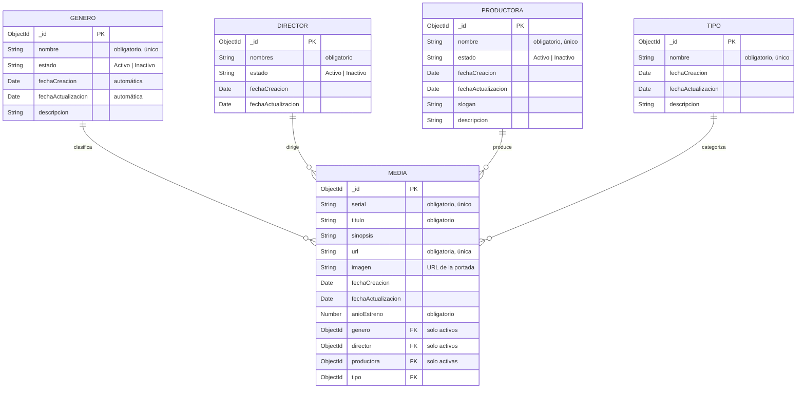

# API REST – Películas y Series (IU Digital de Antioquia)

API REST construida con **Node.js + Express** y **MongoDB (Mongoose)** para administrar los módulos del caso de estudio: **Género, Director, Productora, Tipo y Media** (películas y series).

## 1. Diseño de la base de datos

Base de datos documental **MongoDB** (`peliculas_iud`) con 5 colecciones. Media guarda la referencia (`ObjectId`) a un único género, director, productora y tipo.



### Reglas de negocio implementadas

| Regla | Respuesta |
|---|---|
| `fechaCreacion` y `fechaActualizacion` se asignan automáticamente (no se pueden enviar) | — |
| `estado` solo acepta `Activo` o `Inactivo` (por defecto `Activo`) | 400 |
| Nombre de género, productora y tipo no se repite (sin importar mayúsculas) | 409 |
| `serial` y `url` de Media son únicos | 409 |
| Al crear Media solo se aceptan **género, director y productora activos** y un **tipo existente** | 400 |
| Al editar Media, la regla de "activo" se aplica solo a la referencia que se cambia | — |
| No se puede eliminar un género, director, productora o tipo usado por alguna Media (se sugiere inactivarlo) | 409 |
| Id con formato inválido / registro inexistente | 400 / 404 |

## 2. Instalación y ejecución

Requisitos: **Node.js 20.19 o superior** y una base de datos MongoDB (local, Docker o Atlas).

```bash
npm install
```

```bash
cp .env.example .env
```

Edite `MONGO_URI` en `.env`. Si tiene Docker, puede levantar MongoDB con:

```bash
docker compose up -d
```

Cargar los datos iniciales del caso (géneros: acción, aventura, ciencia ficción, drama, terror; tipos: serie, película; productoras: Disney, Warner, Paramount, MGM). Se puede ejecutar varias veces sin duplicar:

```bash
npm run seed
```

Iniciar el servidor (`npm start`, o con recarga automática):

```bash
npm run dev
```

La API queda en `http://localhost:4000`.

## 3. Endpoints

Todos los módulos exponen las mismas operaciones:

| Método | Ruta | Descripción |
|---|---|---|
| GET | `/api/{modulo}` | Listar |
| GET | `/api/{modulo}/:id` | Obtener por id |
| POST | `/api/{modulo}` | Crear |
| PUT | `/api/{modulo}/:id` | Actualizar (solo los campos enviados) |
| DELETE | `/api/{modulo}/:id` | Eliminar |

`{modulo}` = `generos`, `directores`, `productoras`, `tipos`, `medias`.

Filtros de los listados:

- `GET /api/generos?estado=Activo` (también `directores` y `productoras`), útil para llenar los selectores de Media solo con registros activos.
- `GET /api/medias?titulo=inter&anioEstreno=2014&genero=<id>&director=<id>&productora=<id>&tipo=<id>`

### Ejemplos de cuerpo (JSON)

```json
// POST /api/generos
{ "nombre": "Animación", "estado": "Activo", "descripcion": "Producciones animadas" }

// POST /api/directores
{ "nombres": "Christopher Nolan", "estado": "Activo" }

// POST /api/productoras
{ "nombre": "Legendary Pictures", "estado": "Activo", "slogan": "Legendary", "descripcion": "Productora estadounidense" }

// POST /api/tipos
{ "nombre": "Documental", "descripcion": "Producción de no ficción" }

// POST /api/medias
{
  "serial": "PEL-0001",
  "titulo": "Interestelar",
  "sinopsis": "Un grupo de exploradores viaja a través de un agujero de gusano...",
  "url": "https://peliculas.iudigital.edu.co/interestelar",
  "imagen": "https://peliculas.iudigital.edu.co/img/interestelar.jpg",
  "anioEstreno": 2014,
  "genero": "<id del género>",
  "director": "<id del director>",
  "productora": "<id de la productora>",
  "tipo": "<id del tipo>"
}
```

Las respuestas de Media traen el género, director, productora y tipo con su nombre (populate). Los errores se devuelven como `{ "error": "mensaje", "detalles": [...] }`.

## 4. Pruebas con Postman

1. En Postman: **Import** → `postman/API-Peliculas-IUD.postman_collection.json`.
2. Con el servidor encendido, abra la colección y use **Run collection**. Las peticiones *Crear* guardan los `_id` en variables (`generoId`, `directorId`, …) que usan las demás, así que se ejecutan en orden: crear y consultar cada módulo, crear la Media, probar las reglas de negocio (duplicados, director inactivo, borrar género en uso) y al final eliminar lo creado.
3. Si usa otro puerto, cambie la variable `baseUrl` de la colección.

## 5. Pruebas automáticas

```bash
npm test
```

Ejecuta pruebas de integración de todos los módulos con un MongoDB en memoria (no requiere tener MongoDB instalado).

## 6. Estructura del proyecto

```
src/
├── app.js                 # Configuración de Express y rutas
├── server.js              # Punto de entrada: conecta a MongoDB y levanta el servidor
├── config/db.js           # Conexión a MongoDB
├── models/                # Esquemas Mongoose (diseño de la base de datos)
├── controllers/           # Lógica de cada operación (GET, POST, PUT, DELETE)
├── routes/                # Definición de endpoints por módulo
├── middlewares/           # Validación de id y manejo centralizado de errores
├── helpers/               # Constantes y utilidades
└── seed/seed.js           # Datos iniciales
postman/                   # Colección para Postman
tests/                     # Pruebas de integración
```
